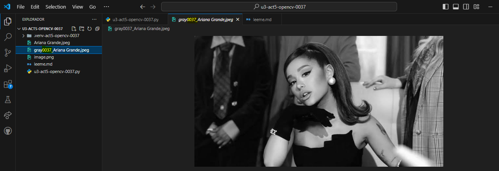
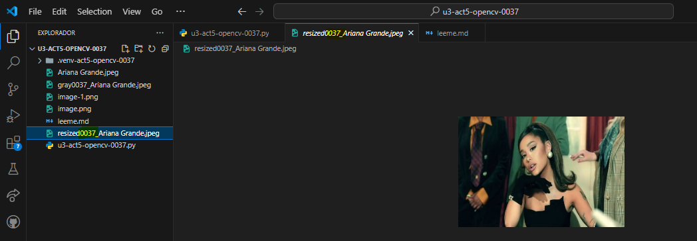
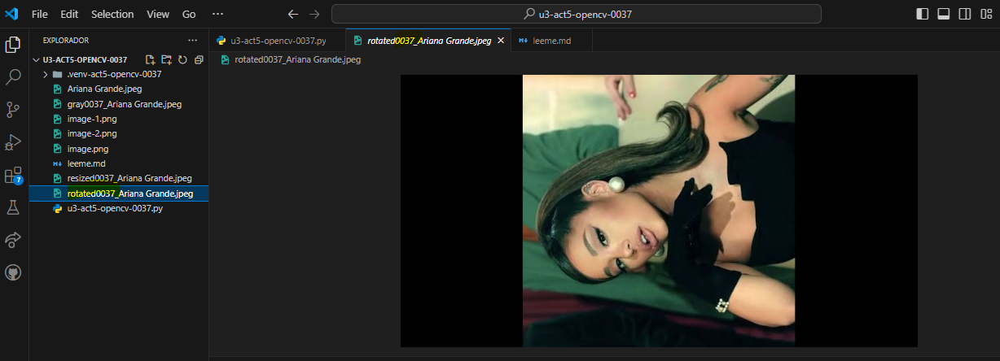
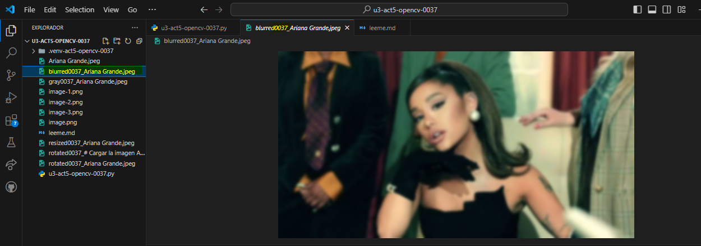
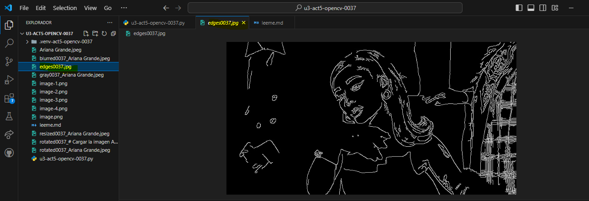
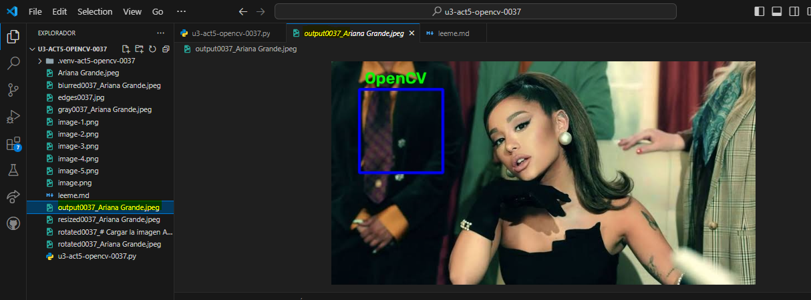
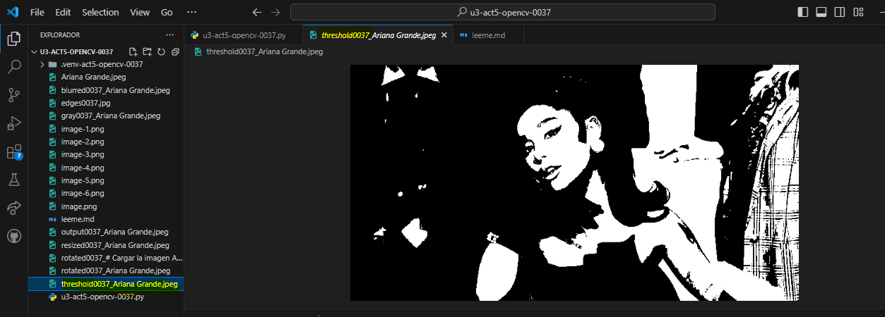
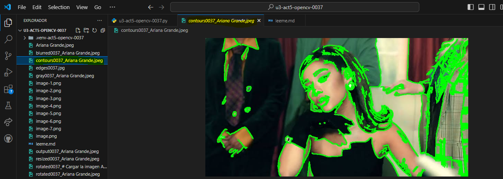

## 2. Lectura y visualización de imágenes
#### 2.1 Ejemplo de código:

## 3. Conversión entre espacios de color
#### 3.1 Ejemplo de código: Convertir una imagen a escala de grises

## 4. Cambiar el tamaño de una imagen
#### 4.1 Ejemplo de código: Cambiar el tamaño de la imagen

## 5. Rotar una imagen
#### 5.1 Ejemplo de código: Girar la imagen 90 grados.

## 6. Desenfoque de una imagen
#### 6.1 Ejemplo de código: Aplicación de un desenfoque gaussiano

## 7. Detección de bordes mediante el algoritmo de Canny
#### 7.1 Ejemplo de código: Detección de bordes mediante el algoritmo de Canny

## 8. Dibujar formas y añadir texto
#### 8.1 Ejemplo de código: Dibujar un rectángulo y añadir texto.

## 9. Umbralización
#### 9.1 Ejemplo de código: Aplicar umbralización binaria

## 10. Detección de contornos
#### 10.1 Ejemplo de código: Detectar contornos y dibujarlos
